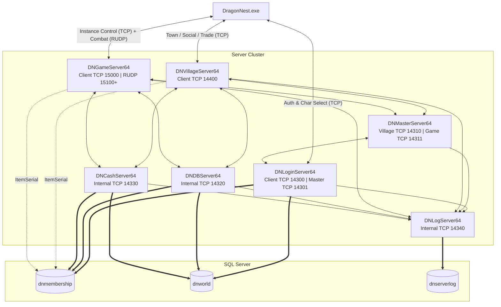

# Server Architecture

IrineCore runs as a cluster of 7 server processes linked over internal TCP channels. Game clients connect over TCP to `DNLoginServer`, `DNVillageServer`, and `DNGameServer`, and over Reliable UDP (`RUDP`) to `DNGameServer` for real-time combat and movement.

## Process Responsibilities

- **`DNLogServer64`** (`src/server/DNLogServer`): Centralized logging receiver. Accepts log packets from the other servers and writes to `dnserverlog` via `dbo.P_AddCommonLog` and `dbo.GameLog`.
- **`DNDBServer64`** (`src/server/DNDBServer`): Asynchronous database worker pool for `DNVillageServer64` and `DNGameServer64`, preventing gameplay loops from blocking on SQL I/O. Routes internal TCP requests across task handlers (`CDNAuthTask`, `CDNCharTask`, `CDNItemTask`, `CDNQuestTask`, `CDNSkillTask`, `CDNTradeTask`, `CDNMailTask`, `CDNGuildTask`, `CDNPartyTask`, `CDNPvPTask`, `CDNFarmTask`, etc.).
- **`DNCashServer64`** (`src/server/DNCashServer`): Handles Cash Shop purchases, Petals, VIP, coupons, gifts, and limited cash items against `dnmembership` and `dnworld`.
- **`DNLoginServer64`** (`src/server/DNLoginServer`): Client entry point. Verifies client version, authenticates accounts (`P_CheckLogin`), handles second passwords, character listing/creation/deletion (`P_AddCharacter`, `P_AddDWCCharacter`, `P_DelCharacter`), reserves auth sessions (`Auth_BeginAuth`), and hands off to `DNVillageServer64` via `DNMasterServer64`.
- **`DNMasterServer64`** (`src/server/DNMasterServer`): World coordinator. Tracks online users, village channels, and game server instances (`CDivisionManager`), arbitrates zone transitions (`Login -> Village`, `Village <-> Game`, `Game -> Game`), and coordinates cross-channel party, PvP, ladder, farm, and guild war state.
- **`DNVillageServer64`** (`src/server/DNVillageServer`): Town and social server. Manages town channels/fields (`CDNField`), NPC dialogues and Lua scripts, quests, inventory, item enhancement/compounding, trading house, mailbox, guilds, friends, and party lobbies.
- **`DNGameServer64`** (`src/server/DNGameServer`): Real-time instance server for dungeons, nests, Dark Lair, Chaos fields, PvP, and farms. Spawns worker threads (`CDNRUDPGameServer`) bound to consecutive UDP ports running 60 FPS simulation rooms (`CDNGameRoom`) with asynchronous map/prop loading (`CDNBackGroundLoader`). Optional modules (such as `Player-Bots`) hook into room and actor lifecycles when enabled at build time.

## Startup Order

Start servers in dependency order so upstream listeners are ready before downstream peers register:

1. `DNLogServer64`
2. `DNDBServer64`
3. `DNCashServer64`
4. `DNMasterServer64`
5. `DNLoginServer64`
6. `DNVillageServer64`
7. `DNGameServer64`

Shut down in reverse order (`DNGameServer64` first, `DNLogServer64` last) so pending character/item flushes reach `DNDBServer64` and `DNLogServer64` before exit.

## Database Access

All database operations go through `CSQLConnection` (`common/database/` + `src/server/ServerCommon/DNSQLMembership.*`, `DNSQLWorld.*`) over standard C ODBC (`odbc32` on Windows, `unixODBC` + `msodbcsql18` on Linux) calling stored procedures (`{?=CALL dbo.P_...}`). Config templates live in `apps/template/config/` and are installed to `env/dist/config/`.
